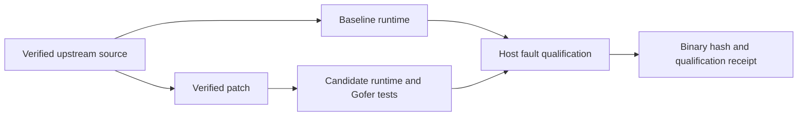

# gVisor storage qualification

`runtime.lock.json` defines the upstream source, toolchain and exact backport
images. `build.py` verifies every downloaded input and both sides of the patch.
The backport makes the existing Gofer sync path return the first host error from
its write and read handles. Read handles carry directory namespace barriers and
can also represent existing files opened without a writer.



The [CI workflow](../../../.github/workflows/gvisor-storage.yml) builds the
baseline and candidate using the same source tree and toolchain. The upstream
`//:release` target assembles runsc, the containerd shim and all matching sidecars.
The release manifest identifies every executable, including the Sentry kernel.
Compiler work
uses one job, reduced CPU priority and a bounded container. Actual Gofer tests
run at normal priority.

[The real runtime fixture](../../../scripts/e2e/gvisor-sync/qualify.py) injects
`EIO`, `ENOSPC` and `EDQUOT` into host `fsync` and `fdatasync` calls. Native
controls establish the injected errors. Both ptrace and systrap exercise
directfs and LISAFS with writable files, existing read-only files and
directories. Normal calls succeed; the candidate returns the original host
error. The baseline records the error-loss counterexample.

Run the fixture on an isolated Linux machine with the namespace capabilities
needed by runsc. Its release manifest hash is an explicit input:

```sh
sudo python3 scripts/e2e/gvisor-sync/qualify.py \
  --runtime=/path/to/release/runsc --manifest=/path/to/release/manifest.json \
  --sha256=REVIEWED_MANIFEST_SHA256 \
  --results=/path/to/new-results
```

Each receipt identifies the executed bytes, fixture sources, platform and
observed syscall results. Deployment qualification also covers the backing
filesystem and device persistence, following the
[Nexus conditional-content contract](https://github.com/nexi-lab/nexus-vfs/blob/main/docs/conditional-content.md).
