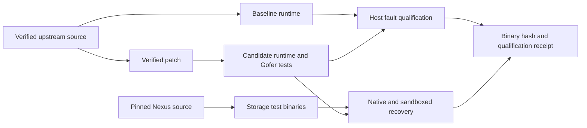
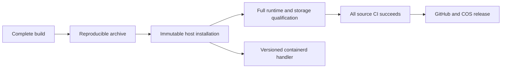

# gVisor storage qualification

`runtime.lock.json` defines the upstream source, toolchain and exact backport
images. `build.py` verifies every downloaded input and both sides of the patch.
The backport makes the existing Gofer sync path return the first host error from
its write and read handles. Read handles carry directory namespace barriers and
can also represent existing files opened without a writer.



The [CI workflow](../../../.github/workflows/gvisor-storage.yml) builds the
baseline and candidate using the same source tree and toolchain. The upstream
`//:release` target assembles runsc, the containerd shim and all matching sidecars.
The release manifest identifies every executable, including the Sentry kernel.
The vendor release label follows gVisor's release-version format, enabling its
default sidecar version enforcement. Builds use the upstream AMD64 optimized
release configuration.
Compiler work uses Bazel file isolation, one job, reduced CPU priority and a
bounded container. The Go SDK source manifest determines the compiler and
analyzer inputs; upstream actions marked `no-sandbox` retain their explicit
local execution strategy. Actual Gofer tests
run at normal priority.

[The real runtime fixture](../../../scripts/e2e/gvisor-sync/qualify.py) injects
`EIO`, `ENOSPC` and `EDQUOT` into host `fsync` and `fdatasync` calls. Native
controls establish the injected errors. Both ptrace and systrap exercise
directfs and LISAFS with writable files, existing read-only files and
directories. Normal calls succeed; the candidate returns the original host
error. The baseline records the error-loss counterexample.

[The Nexus storage fixture](../../../scripts/e2e/gvisor-sync/nexus_storage.py)
runs the existing database and content-store suites first natively, then in all
four runtime/filesystem combinations. It covers concurrent creators, database
reopen, SIGKILL during initialization and publication, complete-content
publication, and file/directory barrier failures. The database suite invokes its
subprocess entry point for each crash phase.

## Distribution and host installation

`release.py` owns full-release verification and checksum-verified downloads.
The builder, archive packager, installer and runtime fixtures share it.
Build receipts identify the recipe bytes that produced the executables.
`package.py` creates a reproducible archive containing the complete `bin/`
fileset, Apache license and build provenance. CI installs this archive, then
runs the full syscall and Nexus matrices from its installed path. The resulting
qualification binds the archive SHA256, executable manifest and source revision.

The [private containerd fixture](../../../scripts/e2e/gvisor-sync/containerd.py)
starts the installed shim through containerd's config-path interface. A CRI
sandbox and its workload container share one sandbox. Both guests complete
file and directory fsync, deliver stdout and stderr, and exit successfully.
The fixture verifies the live shim and Sentry executable hashes and the
versioned runtime root before releasing the guests. Publication requires this
qualification alongside the syscall and Nexus matrices.

The [publication workflow](../../../.github/workflows/publish-gvisor.yml)
consumes a successful `dev` push qualification run. All latest source workflows
and their jobs must succeed before publication. GitHub and Tencent COS receive
the same archive and metadata; public readback verifies complete contents.
The gVisor release has its own tag and content-addressed COS path.



`install.py stage` verifies the archive and publishes a complete directory under
`/opt/moss/runtimes/gvisor/<archive-sha256>/`. Public executable ancestors allow
Sentry traversal; protected ancestors preserve the executable names. Concurrent
installers use the existing version-store directory's OS lock. File and
namespace barriers precede a successful result. A post-publication barrier
error preserves the complete version for retry.

`install.py register-template` appends the versioned handler to a containerd v2
or v3 template. Its shim configuration selects the matching immutable runsc and
an ephemeral runtime root for that version. Existing template entries and runtime
versions retain their identities. The node lifecycle owner reloads containerd
and selects the RuntimeClass after Pod acceptance.

```sh
sudo python3 deploy/runtime/gvisor/install.py stage \
  --archive=/path/to/release.tar.gz --sha256=REVIEWED_ARCHIVE_SHA256 \
  --manifest-sha256=REVIEWED_MANIFEST_SHA256
```

Both fixtures accept `--platform` and `--filesystem` to qualify a deployment's
configured modes. CI uses their complete default matrix. The host's ptrace
policy governs Sentry's use of ptrace, including initialization under systrap.

`scripts/e2e/gvisor-sync/nexus-source.lock.json` pins the Nexus source. Its own
Rust toolchain and protobuf setup remain authoritative. Test executables are
built separately at reduced compiler priority and identified by a payload
manifest. Runtime execution uses the same release verifier, configuration and
log writer as syscall qualification.

Run the fixture on an isolated Linux machine with the namespace capabilities
needed by runsc. The release directory and its ancestors must allow search by
UID 65534, which starts the LISAFS Sentry sidecar. CI stages executables under
an owned `/tmp` directory. Private workspaces hold guest data and namespace
mounts; a separate results directory holds uploadable logs and receipts.
Its release manifest hash is an explicit input:

```sh
sudo python3 scripts/e2e/gvisor-sync/qualify.py \
  --runtime=/path/to/release/runsc --manifest=/path/to/release/manifest.json \
  --sha256=REVIEWED_MANIFEST_SHA256 \
  --results=/path/to/new-results
```

Each receipt identifies the executed bytes, fixture sources, platform and
observed syscall results. Deployment qualification also covers the backing
filesystem and device persistence, following the
[Nexus conditional-content contract](https://github.com/nexi-lab/nexus-vfs/blob/main/docs/conditional-content.md).
