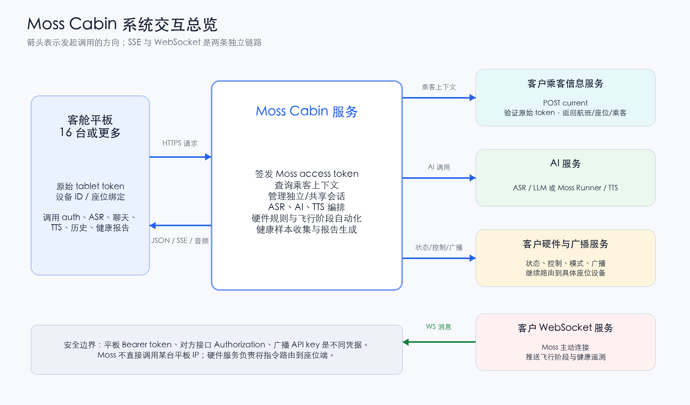
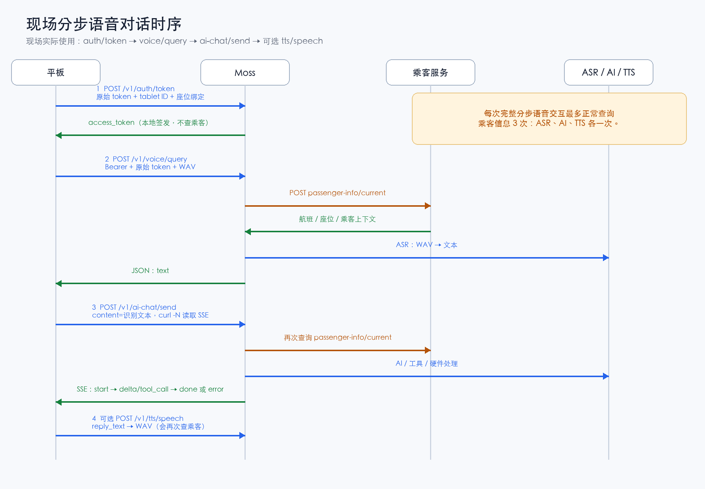
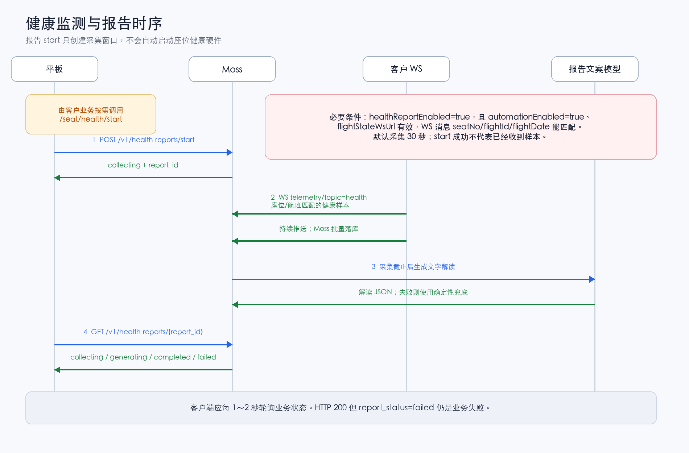

# Moss Cabin 接口交互与现场排障手册

客户联调版 · 2026-10-09 · 文档版本 1.0

适用代码：`codex/cabin-status-mode-tools`，提交 `c4800e2610a97be7b911156c8ad8c1cd54248197`。本文依据该版本源码梳理，现场程序若不是此版本，应先核对构建版本和有效配置。本文没有将源码分析等同于现场接口已验证通过。

现场确认：语音对话使用分步接口；`/v1/voice-chat/send` 代码中已实现，但现场未使用，仅列入附录。

## 1. 先确定故障发生在哪一段

| 业务动作 | 谁调用谁 | 成功标志 | 不能据此证明的事项 |
| --- | --- | --- | --- |
| 领取 Moss token | 平板 → Moss `/v1/auth/token` | 返回 `access_token` | 没有调用乘客信息接口，不能证明原始平板 token 有效或上游正常 |
| 识别用户语音 | 平板 → Moss `/v1/voice/query` → 乘客服务 → ASR | JSON 返回非空 `text` | 还没有生成 AI 回答 |
| 获取 AI 回答 | 平板 → Moss `/v1/ai-chat/send` → 乘客服务 → 对话/工具处理 | SSE 收到 `done` | HTTP 200 或 `start` 不等于生成成功；`tool_call` 不等于硬件执行完成 |
| 播放回答 | 平板 → Moss `/v1/tts/speech` → 乘客服务 → TTS | 收到音频，平板播放 | 对话接口自身不自动返回音频 |
| 飞行阶段自动化 | Moss 连接对方 WS，收到飞行阶段变化后调用硬件/广播接口 | 阶段日志、逐座位检查和下发结果 | `ws.open` 只证明连接建立，不证明消息格式正确 |
| 健康报告 | 平板启动报告；对方 WS 推送采样；平板轮询报告 | `report_status=completed` | start 成功不证明硬件已启动或已采到样本 |

用本文时先查第 3 章流程，再查第 4～8 章参数；复现命令见第 11 章，日志与故障对照见第 10 章。

## 2. 系统边界与公共约定

### 2.1 通信方向



“对方服务”指客户提供的乘客信息、硬件、广播和 WS 服务。Moss 通常不直接 HTTP 请求某台平板的 IP，而是调用这些服务；广播/模式指令由对方服务继续路由到座位端。对方后端到平板/硬件之间的协议不在本仓库实现，需结合对方日志确认。

聊天响应使用 HTTP SSE，健康/飞行数据使用 Moss 主动连接的 WebSocket，两者不是同一条连接。模型运行器内部 socket 也不是向平板公开的 WS 接口。

本文示例地址使用变量：`MOSS_BASE` 为 Moss 地址，`PASSENGER_URL` 为乘客信息完整 URL，`CONTROL_BASE` 为硬件基础地址，`BROADCAST_BASE` 为广播基础地址，`FLIGHT_WS_URL` 为对方 WS 完整地址。IP、端口和凭据以现场有效配置为准。

### 2.2 四类凭据不要混用

| 名称 | 配置/来源 | 使用位置 | 格式 |
| --- | --- | --- | --- |
| 平板原始 token | 由对方平板/登录体系提供 | 平板 → Moss：`X-Cabin-Tablet-Token`；Moss → 乘客服务：`tablet-token` 和 `x-cabin-tablet-token` | 原始值，两个上游头内容相同 |
| Moss access token | `/v1/auth/token` 返回 | 后续平板业务请求的 `Authorization` | `Bearer ai_...`；有效期默认 7200 秒 |
| 对方接口 Authorization | `passengerInfoAuth` / `controlAuth` / `broadcastAuth` | Moss → 对应外部服务 | 配置原样发送，不自动补 `Bearer` |
| 硬件广播 API key | `broadcastApiKey` | 广播、模式接口的 `x-hardware-api-key` | 原样发送；普通硬件状态/控制当前不携带这个 key |

管理接口使用 Moss 管理员身份及 `admin:settings` 权限，不使用 Cabin access token。`tokenSecret` 是 Moss 内部签名配置，不是对方接口 Authorization，也不应传给平板。

### 2.3 平板公共请求头

| 请求头 | `/v1/auth/token` | 后续业务接口 | 说明 |
| --- | --- | --- | --- |
| `X-Cabin-Tablet-Token` | 必填 | 必填 | 缺少/空值返回 401 `MISSING_TABLET_TOKEN` |
| `X-Cabin-Tablet-Id` | 必填 | 必填 | 缺少/空值返回 400 `MISSING_TABLET_ID` |
| `Authorization` | 不要求 | 必填 | `Bearer <Moss access token>` |
| `Content-Type` | `application/json` | 按接口定义 | 上传音频使用 multipart；由 HTTP 客户端生成 boundary |

后续请求会校验 access token 的签名、有效期，并要求 token 内的 tablet ID 和原始 token 与本次两个平板请求头完全一致。平板原始 token 更新后，应重新领取 Moss access token，再整组替换，避免新旧混用。

Cabin `/v1/` 处理链会生成响应头 `x-request-id`，用于关联本次 Moss 入站与出站日志。当前调用对方 HTTP 服务时没有统一透传这个 ID；对方日志应结合时间、接口和座位/设备信息关联。

### 2.4 数据类型、时间与请求大小

- JSON 请求必须为对象，总请求体上限 1 MiB。音频 multipart 总请求体上限 25 MiB，文件上限 10 MiB。
- 音频字段名推荐 `audio`，兼容 `file`；上传一个带文件名的 WAV 文件。代码按扩展名或 MIME 判断，不验证采样率、声道和真实音频编码；具体音频能力需与 ASR 联调确认。
- 通用语音/聊天 `language`：`auto`、`zh`、`en`、`fr`、`ja`、`ko`，默认 `auto`。健康报告语言不使用该枚举校验，建议 `zh`。
- `seatNo` 是现场实际座位编码，`columnNo` 是列/侧位标识；内部 `flightSeatId`、`aircraftSeatId`、`bindingId` 不可拼接成座位号。`A` 和 `01A` 不会被自动视为同一座位。
- `flightDate` 推荐 `YYYY-MM-DD`。token 登记未提供航班日期时使用北京时间当天；健康报告及管理接口中的时间戳为 Unix 毫秒；聊天历史 `create_time` 为带 `+08:00` 的时间字符串。

## 3. 现场实际调用流程

### 3.1 登录后领取 token

平板从自身业务体系取得原始 token、设备 ID、座位绑定字段，再调用 Moss `/v1/auth/token`。Moss 检查请求头和必填字段，先登记托管座位，成功后签发 access token。

这一步不访问乘客信息接口，也不创建完整对话。`flightId`、`flightDate` 未提供时，托管记录使用 `AUTO` 和北京时间当天；后续业务请求仍以乘客接口返回的航班信息为准。数据库登记失败返回 500 `MANAGED_SEAT_REGISTER_FAILED`，不继续签发。

### 3.2 分步语音对话



1. 平板上传 WAV 到 `/v1/voice/query`，携带三项公共身份请求头。
2. Moss 校验 token、设备匹配和上传参数，然后 POST 对方乘客信息接口。
3. 上游成功并返回有效航班信息后，Moss 获取/创建会话，再调用 ASR；返回识别文本。乘客信息失败会在 ASR 之前结束。
4. 平板将识别文本传到 `/v1/ai-chat/send`，建议 `source=voice`。Moss 再次查询乘客信息，再生成回答或执行匹配的工具流程。
5. 平板读取 SSE，直到 `done` 或 `error`；`done.reply_text` 是完整最终回答。
6. 需要播报时，平板将最终回答发到 `/v1/tts/speech`。Moss 再次查询乘客信息并调用 TTS，返回音频，由平板负责播放。

单次完整分步语音交互会触发最多上述三次正常乘客信息查询（识别、回答、合成各一次；不含异常重试）。服务端当前没有为这条链路缓存乘客上下文。

当前版本 `/v1/voice/query` 已将识别文本写成一条用户消息，`/v1/ai-chat/send` 会再次写入传来的文本；分步流程可能在历史里形成两条相同用户文本。这不等于平板重复提交，排查应结合接口路径和 request ID。

### 3.3 文本、硬件状态、控制与模式

文本直接使用 `/v1/ai-chat/send`，无需先调用 `/v1/voice/query`。硬件控制、状态查询和模式切换也通过对话入口触发，没有对平板另行公开通用“执行命令”路由。

当前处理顺序：写入用户消息 → 尝试明确的硬件控制规则 → 对上一条硬件建议的确认处理 → 部分固定舒适度提示 → 模型/运行器处理 → 保存回答并结束 SSE。

- `createMossSession=false`：默认模式，未被规则处理的请求直连 `llmBaseUrl/chat/completions`。推断出的部分 `tool_call`（如普通客舱服务请求）只代表意图，当前没有对应的乘务工单 HTTP 下发实现。
- `createMossSession=true`：复用当前会话的 Moss 运行器；运行器输出结构化控制、状态查询或模式意图，Moss 执行对应接口。硬件脚本在运行器中配置为 `emit` 模式，通常只输出命令，由服务端发 HTTP 请求。
- 控制返回“已下发”表示外部接口接收成功，不表示物理动作已经完成；需要再次查询硬件状态或由对方设备回执确认。
- 对话关闭小桌板时先查询 `tray`：查询失败则阻止关闭；`tray_flipped` 表示仍展开时也阻止关闭，写告警并尝试座位广播。飞行自动化关闭桌板未复用这条对话保护链，详见第 6 章。

### 3.4 多平板和会话隔离

不同请求可以并发进入，各自携带设备、token 和座位上下文。会话键为“`passengerId`，否则 `passengerRef`，再否则 `tablet:<tabletId>`”加 `flightId`，统一去空格并转小写；不是单纯按座位或平板区分。

因此不同乘客通常使用不同会话；同一乘客在同一航班上使用多台平板会共享会话。若对方错误地向多台平板返回相同乘客 ID，可能表现为共享聊天历史。该会话键没有包含 `flightDate`；重复使用同一 flightId 也需检查。

多平板能力不等于已经验证 16 路同时发言的容量。同一会话的重复并发发送、首次建会话竞态及端到端吞吐，应通过现场日志和压测确认；客户端宜等待当前回复结束后再发下一条同会话消息。

## 4. 平板调用 Moss：接口与参数

除领取 token 外，本章业务接口都需要第 2.3 节三项身份请求头，并在处理业务前查询乘客信息。GET 历史、POST reset、TTS、健康报告查询也不例外。

### 4.1 接口总表

| 方法 | 路径 | 请求载荷 | 响应 | 外部依赖 |
| --- | --- | --- | --- | --- |
| POST | `/v1/auth/token` | JSON 座位绑定 | JSON token | 无乘客接口调用 |
| POST | `/v1/voice/query` | multipart WAV | JSON 识别文本 | 乘客服务、ASR |
| POST | `/v1/ai-chat/send` | JSON 文本 | SSE | 乘客服务；按意图调用模型/硬件/广播 |
| GET | `/v1/ai-chat/history` | Query 游标 | JSON 历史 | 乘客服务 |
| POST | `/v1/ai-chat/reset` | 无业务参数 | JSON | 乘客服务 |
| POST | `/v1/tts/speech` | JSON 文本 | 音频二进制 | 乘客服务、TTS |
| POST | `/v1/health-reports/start` | JSON 可选语言 | JSON 报告状态 | 乘客服务；后续依赖 WS/报告文案模型 |
| GET | `/v1/health-reports/{report_id}` | Path 报告 ID | JSON 报告状态/结果 | 乘客服务 |

### 4.2 POST /v1/auth/token

请求体字段如下；“字符串/数值”表示当前实现允许有限数值并转成字符串，推荐统一发送字符串。

| 字段 | 类型 | 必填 | 用途/默认 |
| --- | --- | --- | --- |
| `seatNo` | 字符串/数值 | 是 | 座位号；写入 token 和托管表 |
| `columnNo` | 字符串/数值 | 是 | 列/侧位标识，如 A |
| `flightSeatId` | 字符串/数值 | 是 | 航班座位绑定 ID |
| `aircraftSeatId` | 字符串/数值 | 否 | 飞机座位内部 ID |
| `aircraftId` | 字符串/数值 | 否 | 飞机内部 ID，不等同飞机编号 |
| `aircraftNo` | 字符串/数值 | 否 | 飞机编号；广播/模式场景建议提供 |
| `tabletType` | 字符串/数值 | 否 | 设备类型，当前不做枚举限制 |
| `bindingId` | 字符串/数值 | 否 | 平板绑定 ID |
| `contextStatus` | 字符串/数值 | 否 | 上下文状态，仅携带，不作为航班就绪校验 |
| `passengerGender` | 字符串/数值 | 否 | 乘客称谓上下文补充 |
| `passengerTitle` | 字符串/数值 | 否 | 称谓补充 |
| `flightId` / `flight_id` | 字符串/数值 | 否 | 托管登记用；camelCase 优先，默认 AUTO；不签入 token |
| `flightDate` / `flight_date` | 字符串/数值 | 否 | 托管登记用；camelCase 优先，默认北京时间当天；不签入 token |

请求示例（演示值）：

```json
{"seatNo":"01A","columnNo":"A","flightSeatId":"20","aircraftSeatId":"120","aircraftNo":"AIRCRAFT-DEMO","flightId":"FLIGHT-DEMO","flightDate":"2026-10-09"}
```

成功响应：

```json
{"status":"ok","access_token":"ai_<签名token>","token_type":"Bearer","expires_in":7200}
```

`expires_in` 为秒，取配置 `tokenTtlSeconds`。没有独立 refresh 接口；到期或原始 token 更新后重新调用本接口。认证必填字段缺失返回 400 `INVALID_REQUEST`，message 指明字段名。

### 4.3 POST /v1/voice/query

| multipart 字段 | 类型 | 必填 | 说明 |
| --- | --- | --- | --- |
| `audio`（兼容 `file`） | WAV 文件 | 是 | 单文件 ≤10 MiB |
| `language` | 字符串 | 否 | 通用语言枚举，默认 auto；auto 时不向 ASR 发送显式语言 |

不需要提交 seatNo；座位从乘客接口/token 上下文获得。此接口不生成 AI 回答。

```json
{"status":"ok","seat_id":"01A","language":"zh","text":"请帮我打开阅读灯"}
```

`seat_id` 无值时为空字符串；返回的 language 为请求语言的规范化结果，auto 时使用乘客上下文语言，无可用值时为 `unknown`，不是 ASR 自动识别语言的独立结果。

### 4.4 POST /v1/ai-chat/send

| JSON 字段 | 类型 | 必填 | 说明 |
| --- | --- | --- | --- |
| `content`（兼容 `text`） | 非空字符串 | 是 | content 优先；不接收客户端指定座位覆盖 |
| `source` | 字符串 | 否 | text / voice，默认 text；发送识别文本建议 voice |
| `language` | 字符串 | 否 | 通用语言枚举，默认 auto；这里会校验但不单独覆盖乘客上下文语言 |

```json
{"content":"请帮我打开阅读灯","source":"voice","language":"zh"}
```

成功建立流后 HTTP 200，`Content-Type: text/event-stream; charset=utf-8`。事件用空行分隔，data 是 JSON：

| 事件 | data 字段 | 客户端处理 |
| --- | --- | --- |
| `start` | `status: "ok"` | 流已开始，不代表回答完成 |
| `tool_call` | `id:string`、`name:string`、`arguments:object` | 可选；记录意图/工具上下文，不单独判定执行成功 |
| `delta` | `content:string` | 追加文本；某些路径仅发送一次完整文本，不保证逐 token |
| `done` | `intent:string`、`slots:object`、`reply_text:string` | 正常结束；以 reply_text 作为最终回答 |
| `error` | `code:string`、`message:string`、可选 `retriable:boolean` | 失败结束；不得继续等待 done |

```text
event: start
data: {"status":"ok"}

event: delta
data: {"content":"已为您下发打开阅读灯的指令，请稍候。"}

event: done
data: {"intent":"reading_light_switch","slots":{"execution_status":"dispatched"},"reply_text":"已为您下发打开阅读灯的指令，请稍候。"}
```

以上为事件形态示意，实际 intent/slots 取决于命中的规则/工具。`slots.execution_status` 可能为 dispatched、succeeded、failed、blocked；并非每条路径都提供该字段。失败也可能体现为正常 done 中的失败提示，需结合工具结果与日志。

发送 SSE 头之前的失败使用 JSON 和实际 4xx/5xx；开始 SSE 后 HTTP 状态通常保持 200，通过 error 事件报告。某些已在函数内捕获的错误会使入站完成日志仍记录 200/ok=true，因此不能只看 HTTP 状态或入站日志。

### 4.5 GET /v1/ai-chat/history

| Query 参数 | 类型 | 必填 | 说明 |
| --- | --- | --- | --- |
| `limit` | 整数字符串 | 否 | 默认20，限制1～100；无效值回退20 |
| `before_id` | 消息 ID | 否 | 获取该消息之前的记录，优先于 after_id |
| `after_id` | 消息 ID | 否 | 未传 before_id 时生效 |

游标必须属于当前会话；未知游标当前不报错，而是不加游标过滤。返回选中消息按时间升序排列，系统消息不出现在平板结果中。

| 响应字段 | 类型 | 说明 |
| --- | --- | --- |
| `status` / `mode` | 字符串 | ok / CABIN_AI_CHAT |
| `messages` | 数组 | 消息对象列表 |
| `messages[].id/role/content/source` | 字符串 | ID、角色、正文、来源 |
| `messages[].intent/slots/tool_calls` | 字符串/对象/数组 | 有值时返回；tool_calls 元素为 id/name/arguments |
| `messages[].create_time` | 字符串 | 北京时间，带 +08:00 |
| `next_cursor` | 字符串或 null | 达到查询条数时取首条原始消息 ID，否则 null；通常用于 before_id |

分页使用 created_at 比较；同毫秒多条消息的分页边界与系统消息过滤可能影响条数，不应把 next_cursor 非空当作绝对还有更多记录的保证。

### 4.6 POST /v1/ai-chat/reset

无业务请求体参数，使用公共身份头。返回：

```json
{"status":"ok","cleared":true}
```

当前实现将会话标记为 reset 并插入系统标记，未物理删除消息；下一次建立上下文会复用该会话记录并更新运行器会话 ID。历史读取也没有按 reset 标记截断。因此不能将 `cleared=true` 理解成历史消息已从数据库清空。

### 4.7 POST /v1/tts/speech

| JSON 字段 | 类型 | 必填 | 说明 |
| --- | --- | --- | --- |
| `text`（兼容 `content`） | 非空字符串 | 是 | text 优先；待合成正文 |

```json
{"text":"您好，请问有什么可以帮您？"}
```

成功返回音频二进制及 Content-Type、Content-Length，不是 JSON，也不返回音频 URL。服务端请求 TTS 的 response_format 固定为 wav，返回 Content-Type 优先使用上游值。模型、音色和语言由服务端 tts 配置决定，客户端本接口没有这些覆盖参数。

### 4.8 POST /v1/health-reports/start

要求 `healthReportEnabled=true`。JSON 可为空对象；唯一读取的业务参数 `language` 可选，推荐字符串 zh；回退顺序为请求语言、乘客语言、zh。采集时长和最小样本数由服务端配置，不能通过请求体覆盖；传 seatNo 不会改变报告绑定座位。

```json
{"language":"zh"}
```

成功 HTTP 200，返回初始 collecting 状态；详细响应见第 7 章。

### 4.9 GET /v1/health-reports/{report_id}

`report_id` 为 start 返回的完整字符串 ID，作为路径段传入并 URL 编码；没有业务 Query 参数。每次查询会重新验证公共身份头并查询乘客接口，再读取报告。

404 `HEALTH_REPORT_NOT_FOUND` 表示报告不存在；403 `HEALTH_REPORT_FORBIDDEN` 表示当前有座位上下文且与报告座位不同。当前源码仅在这一层比较座位号，没有同时核验航班、日期或乘客归属，不应把它表述为已实现完整跨航班权限隔离。

## 5. Moss 调用对方乘客信息接口

### 5.1 请求契约

地址取 `passengerInfoUrl`，例如：

```text
POST http://<对方地址>/admin-api/cabin/tablet-passenger-info/current
```

| 项目 | 值 | 说明 |
| --- | --- | --- |
| `Content-Type` | `application/json` | 固定 |
| `tablet-token` | 平板原始 token | 与下一请求头相同 |
| `x-cabin-tablet-token` | 平板原始 token | 兼容两种对方约定 |
| `Authorization` | `passengerInfoAuth` 原值 | 仅配置时发送，不自动添加 Bearer |
| JSON `privacyLevel` | 1～3，默认2 | 来自 `passengerInfoPrivacyLevel` |

```json
{"privacyLevel":2}
```

Moss 每次请求超时 10 秒；发生网络/Fetch 异常时等待 300 ms 后再试一次。HTTP 响应已经返回后不会重试，包括 401、500 等。当前日志只保存顶层错误文本，Node/Bun 常把具体网络原因折叠成 `fetch failed`。

### 5.2 成功响应最低要求

响应可以是 `{code,msg,data}` 包装，也可以把数据直接放在根对象。若存在 `code`，只接受数值0或字符串`"0"`。`data` 中至少必须提供可解析的 `flightId` 和 `flightDate`；座位号可缺失，由 Moss access token 中的 `seatNo` 兜底。

| 上下文字段 | 对方可返回的位置/别名 | 必需 |
| --- | --- | --- |
| `flightId` | `data.flightId/flight_id` 或 `data.flight.flightId/flight_id` | 是 |
| `flightDate` | 同上对应 date 字段 | 是 |
| `seatId` | `data.seatNo/seat_id/seatId` 或 `data.passenger` 下同名字段 | 否，token 兜底 |
| `flightSeatId` | `data.flightSeatId/flight_seat_id` | 否，token 兜底 |
| `flightNo` | `data.flight.flightNo/flight_no` 或 `data` 下同名字段 | 否 |
| `passengerId` | `data.passenger.passengerId/id` | 否 |
| `passengerRef` | `data.passenger.passengerRef/passenger_ref` 或 `data` 下同名字段 | 否 |
| `passengerName` | passenger 或 data 的 `displayName/passengerName/passengerNameMasked` | 否 |
| `passengerGender` | passenger 或 data 的 `gender/sex/passengerGender/passengerSex` | 否 |
| `passengerTitle` | passenger 或 data 的 `title/salutation/passengerTitle` | 否 |
| `language` | passenger 或 data 的 `language` | 否 |

推荐响应：

```json
{
  "code": 0,
  "msg": "success",
  "data": {
    "flightId": "FLIGHT-DEMO",
    "flightDate": "2026-10-09",
    "flightSeatId": "20",
    "seatNo": "01A",
    "flight": {"flightNo": "DEMO001"},
    "passenger": {"passengerId": "PAX-DEMO-001", "displayName": "乘客", "language": "zh"}
  }
}
```

上下文合并规则：乘客接口的 seatId、flightSeatId、性别、称谓优先；没有时使用 Moss token 中相应值。columnNo、飞机/平板绑定字段来自 Moss token。flightId 和 flightDate 必须来自乘客接口，token 内并不保存它们。

### 5.3 错误如何映射

| 对方/网络结果 | Moss 对平板结果 | 现场判断 |
| --- | --- | --- |
| 无法建立请求、连接重置、超时等 | 502 `PASSENGER_INFO_FAILED`，常见 message 含 `fetch failed` | 这是 Moss 包装的 502，不代表对方返回 HTTP 502 |
| 对方 HTTP 非2xx | 502 `PASSENGER_INFO_FAILED`，message 含对方 HTTP 状态 | 看对方 HTTP 日志和鉴权 |
| HTTP 2xx，但业务 code 非0 | 401 `INVALID_TABLET_TOKEN`，message 优先使用对方 msg | 已连通，对方拒绝该 token/业务请求 |
| 2xx/code0，但没有对象数据 | 502 `PASSENGER_INFO_INVALID` | 返回结构不符合契约 |
| 缺 flightId 或 flightDate | 502 `PASSENGER_INFO_INVALID` | 补齐航班上下文 |

`/v1/auth/token` 返回成功不经过这一接口，所以不能用于证明对方乘客接口可用。

## 6. WebSocket、飞行阶段自动化和托管座位

### 6.1 连接生命周期

Moss 在 `cabin.enabled=true` 时创建自动化服务；只有 `automationEnabled=true` 且配置 `flightStateWsUrl` 才会预置 managedSeats 并连接 WS。健康报告也复用这条 WS 接收健康遥测，因此仅开启 `healthReportEnabled` 不足以收到数据。

Moss 是 WS 客户端，不向客户提供 Cabin WS 服务端路径。默认连接参数：握手10秒、每15秒发 ping、60秒无任何 open/message/ping/pong 活动则断开、3秒起指数退避重连至30秒。`flightStateWsHeartbeatIntervalMs=0` 会停止整个心跳定时器，当前也同时停止 idle 检测。

每条 WS 文本首先必须是 JSON 对象。飞行阶段：

```json
{"type":"flight_data","content":"{\"id\":1021,\"mavpacktype\":\"CE25_AUTO_GUIDE_DATA\",\"afcs_status_data\":[0,0,0,0,0,0,0,16]}"}
```

健康遥测：

```json
{"type":"telemetry","content":{"topic":"health","seatNo":"01A","flightId":"FLIGHT-DEMO","flightDate":"2026-10-09","message":{"frame_count":1,"heart_rate":78,"respiratory_rate":18,"spo2":98,"body_temperature":36.6}}}
```

健康 content 也允许 JSON 字符串；飞行数据 content 当前必须是 JSON 字符串，直接对象会记录 `flight_data.invalid_content` 并忽略。

### 6.2 飞行阶段映射

飞行 content 必须满足 `id=1021`、`mavpacktype="CE25_AUTO_GUIDE_DATA"`。阶段码读取 `afcs_status_data[7]`。只有原始阶段码变化才入队；同一阶段码重复消息不重复检查。任务全局串行执行。

| 原始码 | 内部阶段 | 执行任务 | 检查 |
| --- | --- | --- | --- |
| 1 | taxi_in | 是 | 在席、安全带、座椅、桌板 |
| 2 | takeoff_prepare | 是 | 同上 |
| 3、4 | takeoff | 是 | 同上；3→4分别触发 |
| 5、6 | climb | 是 | 在席、安全带；5→6分别触发 |
| 7 | cruise | 否 | 不执行 |
| 8 | descent | 是 | 在席、安全带 |
| 9～15 | landing_approach | 是 | 在席、安全带、座椅、桌板；不同码分别触发 |
| 16 | taxiing | 是 | 在席、安全带、座椅、桌板 |
| 17 / 其他 | go_around / unknown | 否 | 不执行 |

### 6.3 managedSeats 的真实作用

`managedSeats: "A,B,C,E"` 在自动化启动时拆分、去空格、去重，以 `flightId=AUTO`、北京时间当天写入托管表；执行任务时若表中没有 active 记录，还会再次从配置补种。

平板调用 `/v1/auth/token` 也会登记座位；创建/复用对话时，乘客接口得到的真实航班座位还会再登记。自动化读取所有 active 座位，仅按 seatNo 去重。当前没有按当前飞机、航班、日期或 last_seen_at 过滤，也不会因删除配置自动失效旧记录。

所以 managedSeats 是预置座位和空表兜底，同时会扩大实际处理范围；它不是白名单，也不用于补充某次平板请求缺失的 seatNo。填写值必须与硬件服务接受的目标一致，例如实际是 `01A` 时不能填 `A`。

### 6.4 每次阶段任务做什么

1. 读取托管座位，记录 `seat.registry.loaded`。
2. taxiing、climb、descent、landing_approach 生成/复用固定中英文 TTS；其他可执行阶段没有广播文案。
3. 有音频则上传 `audio-all`；广播失败不阻止座位检查。
4. 顺序查询每个座位。safety 读取 presence/seatbelt；posture.position 必须等于0；tray_state 接受 closed/close/0/收起/关闭。
5. 写内部告警；同一座位本次多个异常合并为一条 `error-seat` 广播。
6. 座椅未归位下发 position=0；桌板未关闭下发 close。状态查询失败不盲目控制。
7. 记录 `phase.task.summary`。其 ok 只看控制和状态查询失败，广播/告警推送失败不改变 summary.ok。

当前自动化不检查卫生间占用、乘客偏好，也没有播放结果回调；不能从现有日志确认物理设备最终完成或音频实际播放。

## 7. 健康监测与报告

### 7.1 完整流程



1. UE 调用 `/v1/health-reports/start`；Moss 查询乘客上下文，确定 seat/flight/date，创建 collecting 报告并启动默认30秒计时。
2. 对方通过第6章同一 WS 推送 `telemetry/topic=health`。
3. Moss 将有效样本归入当前报告；每1秒或新增10条时批量落库。
4. 采集到期后计算指标和分数，调用 LLM 只生成文字解读；模型失败或格式错误使用确定性兜底文案。
5. UE 使用 report_id 每1～2秒轮询，直到 completed、failed 或 cancelled。

当前现场 UE 健康报告流程不调用 `/v1/ai-chat/send`，也不调用健康硬件 start/stop；健康样本由客户侧现有 WS 链路推送。

在同一 aircraftNo + flightId + flightDate + seatNo 上再次 start，会取消旧的 collecting/generating 报告，旧报告返回 cancelled / `SUPERSEDED_BY_NEW_REPORT`。服务重启后内存活动窗口和定时器不会自动恢复，数据库未完成记录也没有本实现自动标为 expired；现场应避免采集中重启并检查遗留状态。

### 7.2 WS 样本匹配与有效范围

健康 envelope 必须 type=telemetry，content.topic=health，content.seatNo 非空。先以 seatNo 匹配活动报告；消息带 aircraftNo、flightId、flightDate 时进一步约束。匹配多条活动报告时样本因歧义被忽略。

message 中至少一个指标有效即可形成一条 sample：

| 指标 | 接受范围 | 正常范围 | 汇总方式 |
| --- | --- | --- | --- |
| heart_rate | 20～180 bpm | 60～100 | 有效样本平均，整数 |
| respiratory_rate | 6～30 breaths/min | 16～20 | 有效样本平均，整数 |
| spo2 | 80～110 % | 95～100 | 有效样本平均，整数 |
| body_temperature | 20～45 ℃ | 36.1～37.2 | 有效样本平均，1位小数 |

值可为数字或数字字符串。范围外单项被丢弃；frame_count 可选。接受范围是程序过滤范围，不代表医学合理范围。报告只要求总 sample 数达到 `healthReportMinSamples`（默认1），不要求四项齐全；缺失指标可显示 missing，报告仍可能 completed。

### 7.3 报告状态和响应

| 状态 | 含义 | 关键字段 |
| --- | --- | --- |
| collecting | 采集窗口内 | progress、started_at、estimated_completed_at、sample_count |
| generating | 正在聚合/生成文案 | 同上；预计时间只是采集截止 |
| completed | 报告完成 | flight_id/date、generated_at、metrics、summary |
| failed | 生成失败 | error_code、error_message；常见 INSUFFICIENT_SAMPLES |
| cancelled | 被新报告替代 | SUPERSEDED_BY_NEW_REPORT |
| expired | 类型中定义 | 当前实现未见自动进入该状态的流程 |

completed 的 metrics 每项包含 value、unit、level 和 range；summary 包含 score、score_level（good≥80、pass≥60、否则fail）、emotion_status、physiology_status、metric_levels、overview、interpretations、suggestions、disclaimer。LLM 不负责重算指标和分数。

采样不足时 HTTP 查询仍可返回200，业务状态为 failed；客户端必须看 `report_status`，不能只看 HTTP 或顶层 `status=ok`。

## 8. Moss 调用对方硬件和广播接口

### 8.1 通用约定与状态查询

普通状态/控制以 `controlBaseUrl` 为基础，配置 `controlAuth` 时原样发送 Authorization，默认超时 `controlTimeoutMs=10000`。对话路径通常要求 HTTP 2xx 且业务 code=0；自动化兼容缺少 code。推荐统一返回 `{"code":0,"msg":"success","data":{}}`。

```text
GET {controlBaseUrl}/admin-api/tcp/hardware/status?target=<target>&key=<key>
```

target 为座位号；客舱级状态使用 `cabin`。key 支持 posture、tray、safety、comfort、reading_light、glass_state、ceiling_state。推荐响应：

```json
{"code":0,"data":{"aircraftNo":"AIRCRAFT-DEMO","target":"01A","key":"tray","data":{"tray_state":"closed","tray_flipped":false},"lastUpdateTime":1791532800000}}
```

自动化使用 safety/posture/tray；对话可查询全部 key。对话只读取嵌套 `data.data`；lastUpdateTime 只在数值类型时使用。空 data 可能被视为接口成功但状态未知。

### 8.2 控制接口目录

全部为 POST，参数放 Query，正文为空；完整前缀为 `/admin-api/tcp-client/cmd`：

| 后缀路径 | 必填 Query | 允许值 |
| --- | --- | --- |
| `/seat/cushion` | seatNo, position | position 0～100 |
| `/seat/ventilation` | seatNo, level | 0～3 |
| `/seat/heating` | seatNo, level | 0～3 |
| `/seat/massage` | seatNo, level | 0～3 |
| `/seat/tray/open`、`/seat/tray/close` | seatNo | — |
| `/seat/light` | seatNo, on；pwm可选 | on布尔；pwm 0～1000 |
| `/seat/light/brightness` | seatNo, pwm | 0～1000 |
| `/seat/health/start`、`/seat/health/stop` | seatNo | — |
| `/cabin/ceiling/color` | seatNo,r,g,b,brightness | RGB 0～255；brightness 0～100 |
| `/cabin/ceiling/light` | seatNo,on | 布尔 |
| `/cabin/scene` | seatNo,preset | boarding/cruise/night/landing |
| `/cabin/scene/clear` | seatNo | — |

客舱级接口当前也传 seatNo。对话层会约束整数范围，对方仍应自行校验。控制返回“已下发”表示接口接收成功，不表示物理动作完成；应复查硬件状态。关闭桌板的对话路径先查 tray，查询失败或 tray_flipped 为真时阻止关闭并告警；飞行自动化的关闭路径未复用该保护。

表中的 `/seat/health/start`、`/seat/health/stop` 是通用硬件控制能力，不属于当前 UE 健康报告调用流程。

### 8.3 广播与模式接口

基础地址优先 `broadcastApiBaseUrl`，否则回退 `controlBaseUrl`。请求头为 `x-hardware-api-key: <broadcastApiKey>`；可选 Authorization 优先 broadcastAuth，否则 controlAuth。

| 接口 | 载荷 | 用途 |
| --- | --- | --- |
| POST `/admin-api/cabin/broadcast/audio-all` | multipart：file(WAV)、title、aircraftNo | 阶段全机广播 |
| POST `/admin-api/cabin/broadcast/error-seat` | JSON：aircraftNo、seatNo、title、content、contentEN | 座位异常/桌板提醒 |
| POST `/admin-api/cabin/broadcast/mode-seat` | JSON：mode、title、aircraftNo、seatNo | office/relax/sleep/personal 模式 |

scene preset 与 mode 是两套能力，不可混用。阶段广播要求 broadcastEnabled、基础地址和 broadcastApiKey；缺一即跳过。mode-seat 当前即使没有 API key 也会发请求，且没有检查 broadcastEnabled；现场配置仍应完整，对方应返回明确 code。

### 8.4 本地广播文件

`GET/HEAD /v1/cabin/broadcasts/{filename}` 提供 `<rootDir>/cabin-broadcasts` 中缓存文件，仅允许字母、数字、下划线、点和连字符。它不要求平板 token，生产网络需限制暴露。若自定义 `broadcastTtsCacheDir`，当前下载路由仍固定读取默认目录，可能与缓存目录不一致。正式 audio-all 直接上传文件，不依赖下载 URL。

## 9. 关键配置与生效条件

| 能力 | 必需/关键配置 | 说明 |
| --- | --- | --- |
| Cabin 平板 API | enabled、tokenSecret、passengerInfoUrl | tokenSecret 生产必须修改；passengerInfoAuth按对方要求 |
| ASR/TTS/聊天 | asrUrl/model、ttsUrl/model/voice/language、llmBaseUrl/model | API key按服务要求；普通ASR/TTS/直连LLM当前无本层显式超时 |
| 硬件控制 | controlBaseUrl；可选controlAuth、controlTimeoutMs | controlTimeoutMs也用于健康文案模型、自动化TTS/广播 |
| 飞行WS/自动化 | automationEnabled、flightStateWsUrl、controlBaseUrl | aircraftNo建议配置；managedSeats为预置/兜底 |
| 广播 | broadcastEnabled、broadcastApiKey、广播基础地址 | broadcastAuth可选；基础地址可回退controlBaseUrl |
| 健康报告 | healthReportEnabled、自动化WS连接、有效health消息 | collect默认30秒、minSamples默认1；LLM失败有文案兜底 |
| Moss 会话模式 | createMossSession、assistantName、replyTimeoutMs | 默认关闭；关闭时走普通chat completions |

环境变量优先于 server.json，例如 `CABIN_PASSENGER_INFO_URL`、`CABIN_PASSENGER_INFO_AUTH`、`CABIN_CONTROL_BASE_URL`、`CABIN_FLIGHT_STATE_WS_URL`。排障必须查看进程/容器实际环境，不能只看文件。修改配置或环境变量后应重启；managedSeats 已写入数据库的旧记录不会因删除配置自动消失。

### 9.1 参考 server.json 的核对结论

随项目提供的现场 `server.json` 可以作为联调字段样本，但不能原样作为生产配置。根据本版本配置 schema 和实际调用代码，需特别处理以下项目：

| 样本项 | 当前含义/问题 | 建议 |
| --- | --- | --- |
| `tokenSecret: "dev-cabin-token-secret"` | 开发默认签名密钥；知道该值的人可伪造 Moss access token | 生产替换为高强度随机密钥，通过密钥管理或环境变量注入 |
| `flightStateDemoEnabled: true` | 开放无 Cabin 鉴权的 demo 路由 | 仅现场演示临时开启，生产设为 false |
| `createMossSession: true` | 未命中确定性规则的聊天会创建/复用完整 Moss runtime session | 只有 runtime 镜像、assistant 和恢复链路均已部署验证时开启；否则使用默认 false |
| `managedSeats: "A,B,C,E"` | A/B/C/E 会被当成完整硬件 target，不会自动补排号；数据库旧 active 记录仍继续参与自动化 | 必须使用硬件接口实际接受的完整座位编码，并通过管理接口核对有效列表 |
| `healthReportModelTimeoutMs: 30000` | 当前版本没有此配置字段，解析后会被忽略 | 删除该字段；当前健康报告模型超时实际复用 `controlTimeoutMs`。若必须单独配置30秒，需要先修改代码增加正式配置项 |
| `controlAuth`、`passengerInfoAuth`、`broadcastApiKey`、WS URL 中的 key | 样本为明文联调凭据 | 交付前全部轮换；不要写入公开文档、日志截图或代码仓库 |

样本中 `healthReportCollectSeconds=30`、`healthReportMinSamples=1` 会生效；`healthReportEnabled=true` 只开放报告 API，仍需 `automationEnabled=true`、有效 `flightStateWsUrl` 及匹配的健康遥测才能采到数据。`broadcastApiBaseUrl` 未配置时会回退 `controlBaseUrl`，因此样本的广播和模式接口实际也请求硬件服务基础地址。

建议生产配置至少显式补齐 WS 超时/重连项、`broadcastApiBaseUrl`、日志路径，并使用脱敏占位符形成配置模板。完整可识别字段及环境变量映射见同目录《Cabin server.json 配置参考》；任何不在当前配置 schema 中的字段都不能假定已经生效。

## 10. 日志和故障定位

### 10.1 日志文件

| 日志 | 默认位置 | 内容 |
| --- | --- | --- |
| Cabin API 日志 | `<rootDir>/logs/cabin.jsonl` | 平板入站、passenger-info、ASR/TTS/LLM、对话硬件请求、健康报告事件 |
| 自动化日志 | `<rootDir>/logs/cabin-automation.jsonl` | WS、阶段变化、广播、逐座位状态/控制、健康原始消息 |

两者默认50 MiB滚动。Cabin 日志常见 request_id、tablet_id、seat_no、flight_id、path/upstream、status、ok、elapsed_ms、error_code/message、details。URL 查询中敏感参数会脱敏；请求头 token 不写入结构化日志。

### 10.2 症状对照

| 现象 | 首查与判断 |
| --- | --- |
| auth/token 401 MISSING_TABLET_TOKEN | 对方调用 Moss 未传/传空 X-Cabin-Tablet-Token；不会继续调乘客接口 |
| auth/token 200，后续 502 fetch failed | auth 本地成功不代表上游正常；查 passenger-info、运行环境网络和底层 cause |
| 固定平板失败、其他正常 | 对比原始 token、tablet ID、座位绑定和对方 passengerInfo 业务日志 |
| 同一 token 时好时坏 | 查网络、对方并发/连接、Moss代理与连接复用；部分成功不能排除任一方 |
| voice/query 失败且无 ASR 日志 | 故障在鉴权、multipart 或 passenger-info 之前/期间 |
| voice/query 成功，ai-chat无回答 | 查第二次 passenger-info、SSE error、LLM/session、工具日志 |
| HTTP 200但界面一直等待 | 检查 SSE 空行和 event/data解析，是否在 done/error 结束 |
| 健康报告最终 failed | 查 ws.message.raw、sample.accepted/ignored、座位/航班匹配和 minSamples |
| WS open但阶段不处理 | 查type、content是否字符串、id/mavpacktype、数组第8项和duplicate/skipped |
| 阶段变化但seats为空 | 平板未登记且managedSeats为空；查 seat.registry.loaded |
| 配置A却请求旧座位 | 托管表旧active记录未失效；用管理接口查实际列表 |
| 硬件HTTP 200仍提示失败 | 对话控制要求业务code=0；查响应正文 |
| dispatched但设备没动 | dispatched只表示接口接收；查对方网关、设备下发和最终状态 |

常见的 `elapsed_ms≈300ms` 加 `fetch failed`，可能是第一次快速网络失败、等待300ms后第二次仍快速失败；不是300ms超时。当前代码未记录 `error.cause`。curl正常而进程fetch失败时，应在相同容器/进程环境打印cause，并检查 HTTP_PROXY/HTTPS_PROXY/NO_PROXY；内网地址建议加入 NO_PROXY。

## 11. 现场 curl 验证命令

以下命令使用演示值。先在运行 Moss 的同一台主机或同一容器网络环境中设置变量；不要把真实 token 写入聊天记录、工单截图或公共脚本。

```bash
export MOSS_BASE='http://127.0.0.1:43128'
export PASSENGER_URL='http://192.168.20.2:48081/admin-api/cabin/tablet-passenger-info/current'
export TABLET_TOKEN='替换为平板原始token'
export TABLET_ID='替换为平板设备ID'
export PASSENGER_AUTH='替换为server.json中passengerInfoAuth的完整原值'
export WAV_FILE='/tmp/test.wav'
```

`PASSENGER_AUTH` 不是 `/v1/auth/token` 返回的 access token。若对方乘客接口不要求 Authorization 且 `passengerInfoAuth` 未配置，应删除对应 `-H` 行，不能发送字面量“替换为……”或空的 Authorization。

### 11.1 直接验证对方乘客信息接口

```bash
curl -i -sS --max-time 15 \
  -X POST "$PASSENGER_URL" \
  -H 'Content-Type: application/json' \
  -H "tablet-token: $TABLET_TOKEN" \
  -H "x-cabin-tablet-token: $TABLET_TOKEN" \
  -H "Authorization: $PASSENGER_AUTH" \
  --data '{"privacyLevel":2}'
```

该命令必须是 POST。只执行 `curl http://.../current` 会发送 GET；其 401 不能直接证明 Moss 的 POST 调用也会401。判定可用至少要同时满足：网络能连接、HTTP 为2xx、业务 `code` 为0、数据中有 `flightId` 和 `flightDate`。若现场进程在容器内，应进入同一容器执行，宿主机 curl 成功不能证明容器路由、代理和 DNS 一致。

### 11.2 领取 Moss access token

```bash
AUTH_JSON=$(curl -sS -D /tmp/cabin-auth.headers \
  -X POST "$MOSS_BASE/v1/auth/token" \
  -H 'Content-Type: application/json' \
  -H "X-Cabin-Tablet-Token: $TABLET_TOKEN" \
  -H "X-Cabin-Tablet-Id: $TABLET_ID" \
  --data '{
    "seatNo":"01A",
    "columnNo":"A",
    "flightSeatId":"20",
    "aircraftSeatId":"120",
    "aircraftNo":"AIRCRAFT-DEMO",
    "flightId":"FLIGHT-DEMO",
    "flightDate":"2026-10-09"
  }')
printf '%s\n' "$AUTH_JSON"
export MOSS_TOKEN=$(printf '%s' "$AUTH_JSON" | jq -r '.access_token // empty')
test -n "$MOSS_TOKEN" && echo 'Moss access token received'
```

没有安装 jq 时可从 JSON 的 `access_token` 字段手工复制：

```bash
export MOSS_TOKEN='ai_替换为auth/token返回的access_token'
```

本步骤不访问乘客信息接口。成功只能证明平板请求头、座位绑定参数、托管座位登记和 Moss 签名功能正常。

### 11.3 语音识别

```bash
curl -i -sS \
  -X POST "$MOSS_BASE/v1/voice/query" \
  -H "Authorization: Bearer $MOSS_TOKEN" \
  -H "X-Cabin-Tablet-Token: $TABLET_TOKEN" \
  -H "X-Cabin-Tablet-Id: $TABLET_ID" \
  -F "audio=@$WAV_FILE;type=audio/wav" \
  -F 'language=zh'
```

若这里返回 passenger-info 相关错误，说明请求已经进入需要查询乘客上下文的阶段；若返回 ASR 错误，则乘客接口通常已经通过，应继续查 ASR 配置和日志。

### 11.4 AI 对话 SSE

```bash
curl -N -i -sS \
  -X POST "$MOSS_BASE/v1/ai-chat/send" \
  -H 'Content-Type: application/json' \
  -H 'Accept: text/event-stream' \
  -H "Authorization: Bearer $MOSS_TOKEN" \
  -H "X-Cabin-Tablet-Token: $TABLET_TOKEN" \
  -H "X-Cabin-Tablet-Id: $TABLET_ID" \
  --data '{"content":"请帮我打开阅读灯","source":"voice","language":"zh"}'
```

`-N` 禁止 curl 缓冲，便于逐条看到 SSE。正常应出现 start，随后出现 delta/tool_call，最终以 done 结束；出现 error 后即为失败结束。

### 11.5 TTS 音频

```bash
curl -sS -D /tmp/cabin-tts.headers \
  -X POST "$MOSS_BASE/v1/tts/speech" \
  -H 'Content-Type: application/json' \
  -H "Authorization: Bearer $MOSS_TOKEN" \
  -H "X-Cabin-Tablet-Token: $TABLET_TOKEN" \
  -H "X-Cabin-Tablet-Id: $TABLET_ID" \
  --data '{"text":"您好，请问有什么可以帮您？"}' \
  --output /tmp/cabin-tts.wav
file /tmp/cabin-tts.wav
cat /tmp/cabin-tts.headers
```

### 11.6 健康报告 start 和轮询

```bash
HEALTH_JSON=$(curl -sS \
  -X POST "$MOSS_BASE/v1/health-reports/start" \
  -H 'Content-Type: application/json' \
  -H "Authorization: Bearer $MOSS_TOKEN" \
  -H "X-Cabin-Tablet-Token: $TABLET_TOKEN" \
  -H "X-Cabin-Tablet-Id: $TABLET_ID" \
  --data '{"language":"zh"}')
printf '%s\n' "$HEALTH_JSON"
export REPORT_ID=$(printf '%s' "$HEALTH_JSON" | jq -r '.report_id // empty')

curl -i -sS \
  "$MOSS_BASE/v1/health-reports/$REPORT_ID" \
  -H "Authorization: Bearer $MOSS_TOKEN" \
  -H "X-Cabin-Tablet-Token: $TABLET_TOKEN" \
  -H "X-Cabin-Tablet-Id: $TABLET_ID"
```

start 后还必须有匹配座位/航班的 WS 健康样本。

### 11.7 直接验证硬件状态

```bash
export CONTROL_BASE='http://替换为硬件服务地址'
export CONTROL_AUTH='替换为server.json中controlAuth的完整原值'

curl -i -sS --get \
  "$CONTROL_BASE/admin-api/tcp/hardware/status" \
  -H "Authorization: $CONTROL_AUTH" \
  --data-urlencode 'target=01A' \
  --data-urlencode 'key=tray'
```

`controlAuth` 未配置时删除 Authorization 行。HTTP 2xx 之外，还要检查业务 `code=0` 和 `data.data` 中的实际状态。

## 12. 错误码、管理接口和非现场主流程路由

### 12.1 平板接口主要错误码

错误 JSON 统一形态为 `{"status":"error","code":"...","message":"..."}`。SSE 开始后的错误使用 error 事件，data 中提供 code/message。

| HTTP | code | 含义/处理 |
| --- | --- | --- |
| 400 | MISSING_TABLET_ID | 缺少 `X-Cabin-Tablet-Id` |
| 401 | MISSING_TABLET_TOKEN | 缺少平板原始 token 请求头 |
| 401 | MISSING_AUTHORIZATION | 后续业务接口缺少 Moss Bearer token |
| 401 | TOKEN_EXPIRED | Moss access token 已过期；重新领取 |
| 403 | INVALID_AUTHORIZATION | Moss access token 签名或格式无效 |
| 401 | UNAUTHORIZED | access token 内的原始 token/tablet ID 与本次请求头不一致 |
| 400 | INVALID_JSON / INVALID_REQUEST | JSON 格式或必填/枚举参数错误 |
| 413 | PAYLOAD_TOO_LARGE | 整个请求体超过限制 |
| 400 | INVALID_MULTIPART / MISSING_AUDIO / AUDIO_TOO_LARGE / INVALID_AUDIO_FORMAT | 音频表单、大小或 WAV 判断失败 |
| 500 | PASSENGER_INFO_NOT_CONFIGURED | 未配置乘客信息 URL |
| 502 | PASSENGER_INFO_FAILED | 对方网络失败或 HTTP 非2xx；message 给出顶层原因/状态 |
| 401 | INVALID_TABLET_TOKEN | 对方 HTTP 2xx 但业务 code 非0 |
| 502 | PASSENGER_INFO_INVALID | 对方成功响应缺 data、flightId 或 flightDate |
| 500 | MANAGED_SEAT_REGISTER_FAILED | auth/token 写托管座位失败 |
| 400 | ASR_NO_SPEECH | ASR 未返回有效文字 |
| 500 | ASR_FAILED | ASR 调用失败 |
| 500 | AGENT_FAILED | LLM/Moss 会话或运行器失败，可能出现在 SSE error |
| 400 | MISSING_CONTENT / MISSING_TEXT | 对话正文或 TTS 正文缺失 |
| 404 | HEALTH_REPORT_DISABLED | 健康 API 配置关闭 |
| 400/403/404 | MISSING_SEAT_CONTEXT / HEALTH_REPORT_FORBIDDEN / HEALTH_REPORT_NOT_FOUND | 报告缺座位、座位不匹配或 ID 不存在 |
| 500 | INTERNAL_ERROR | 未映射异常；查同一 x-request-id 的服务端日志 |

健康报告样本不足通常不是 HTTP 错误：查询返回 HTTP 200，但 `report_status=failed`、`error_code=INSUFFICIENT_SAMPLES`。

### 12.2 管理查询接口

以下接口属于 Moss 管理 API，需要 Moss 管理员凭据且具备 `admin:settings` scope；Cabin access token 和平板原始 token 均不能替代。

| 方法和路径 | 查询参数 | 主要用途 |
| --- | --- | --- |
| GET `/api/v1/cabin/conversations` | flight_id、flight_date、seat_id、passenger、status=active/reset、limit、offset | 会话列表；limit 最终限制1～200 |
| GET `/api/v1/cabin/conversations/{id}` | 无 | 会话详情及最多200条消息 |
| GET `/api/v1/cabin/alerts` | flight_id、flight_date、seat_no、status=active/resolved、limit、offset | 自动化告警列表 |
| GET `/api/v1/cabin/managed-seats` | aircraft_no、flight_id、flight_date、active；active 默认不等于 false | 查看真正参与托管的数据 |

示例：

```bash
export ADMIN_TOKEN='替换为有admin:settings权限的Moss管理token'

curl -sS "$MOSS_BASE/api/v1/cabin/managed-seats?active=true" \
  -H "Authorization: Bearer $ADMIN_TOKEN" | jq .

curl -sS "$MOSS_BASE/api/v1/cabin/alerts?status=active&limit=50" \
  -H "Authorization: Bearer $ADMIN_TOKEN" | jq .
```

管理接口是排查工具，不属于平板业务契约。特别是 managed-seats 查询能发现配置已删除但数据库仍 active 的旧座位。

### 12.3 代码存在但现场未使用：POST /v1/voice-chat/send

该接口把 WAV 识别与对话合为一条 SSE，代码中已实现，但现场确认没有实际使用。当前现场主流程仍是 `/v1/voice/query` 后调用 `/v1/ai-chat/send`，不要把本接口写入客户的必调步骤，也不能用它的测试结果替代分步链路验证。

本接口参数为 multipart：audio/file、language、source；SSE 比普通聊天多一个 `asr_result` 事件。它只查询一次乘客信息。保留此说明用于辨认日志和后续兼容，不作为本次联调推荐接口。

### 12.4 Demo 与广播文件路由

`POST /v1/cabin-demo/flight-state`、`GET /v1/cabin-demo/alerts`、`GET /v1/cabin-demo/broadcasts` 只在 `flightStateDemoEnabled=true` 时可用，是本地演示链路；它们没有平板/Cabin token 校验，不应作为生产飞行状态接入方式，也不应暴露到不受信网络。

`GET/HEAD /v1/cabin/broadcasts/{filename}` 是缓存音频文件下载路由，同样没有 Cabin 鉴权。生产应通过网络边界限制访问，并核对第8.4节所述缓存目录差异。

## 13. 客户联调验收清单

建议每台平板保存 tablet ID、座位号、测试时间、各接口 x-request-id 和结果；不要保存完整 token。16台接入时至少逐台完成身份/座位检查，再做并发测试。

| 阶段 | 验收动作 | 通过标准 |
| --- | --- | --- |
| 版本和配置 | 核对运行提交、server.json 与实际环境变量 | 确认生效值，不只看静态文件 |
| 对方乘客接口 | 在 Moss 同一网络环境执行11.1 POST | 2xx、code0、flightId/date正确，16个原始 token 均验证 |
| Moss token | 每台平板调用 auth/token | access_token 非空；托管列表 tablet/seat 匹配 |
| 身份隔离 | 故意交换一组 tablet ID/token | 后续请求被拒绝，不串会话 |
| 语音识别 | 每台上传合规 WAV | 返回 text；乘客接口和 ASR 日志可按 request ID 关联 |
| AI SSE | 测文本、语音来源及硬件指令 | 客户端正确处理 start/delta/tool_call/done/error，不只看 HTTP 200 |
| TTS | 合成并播放中英文样例 | Content-Type/音频有效，平板能播放 |
| 历史与 reset | 分页读取并执行 reset | 客户接受当前“reset不物理清空历史”的行为 |
| 硬件 | 状态、控制、控制后复查 | HTTP 与业务 code 成功，最终物理状态确认 |
| WS 飞行数据 | 推送合法、重复、错误格式消息 | 合法阶段处理；重复码不重跑；错误格式记录且不误动作 |
| 托管座位 | 比对 managed-seats 与真实目标 | 无旧 active 座位；编码与硬件 target 完全一致 |
| 健康报告 | start、推样本、轮询完成 | 样本归属正确；completed 或可解释的业务失败 |
| 并发 | 16台同时执行约定场景 | 记录成功率、P95、上游负载；无身份/历史串线 |
| 故障演练 | 断乘客接口、停 WS、令 token 过期 | 错误码和恢复路径符合本文，日志足以定位 |

“部分平板正常”只能说明系统具备处理成功请求的能力，不能据此排除 Moss、对方服务、网络或特定 token 数据问题。应按 tablet ID、原始 token 对应关系、座位、x-request-id 和时间逐条比较成功与失败样本。多平板并发属于代码设计能力；16路现场容量仍需用上述并发验收数据确认。
