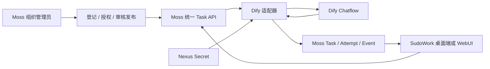

# Dify 外部智能体接入：开发与测试总结

更新日期：2026-10-13。本文覆盖需求实施、管理入口迁移、桌面/WebUI 命名统一，以及三个仓库 rebase 后的验证和 PR 交付。

## 1. 交付结果

组织管理员在 Moss 的“智能体管理 → 专属智能体 → 外部托管”接入、授权和发布 Dify 应用；授权用户在 SudoWork 的“智能体列表 → 专属智能体 → 外部托管”选择应用，进入统一对话并查看历史。

桌面端和 WebUI 共用“智能体库 / 专属智能体 / 我的智能体”页签。专属页分为“外部托管 / 内部托管”；Moss 对应分区分别提供“接入外部智能体”和“创建智能体”，内部类型/可见性筛选也放在内部托管分区。

这是已验证的合成数据试点。生产准入、正式通用 Task 契约、所有外部平台的即插即用能力，不在本次完成声明内。

## 2. 仓库、基线与 PR

统一工作分支：`codex/dify-external-pilot-20261012`。

| 仓库 | rebase 目标及本次拉取的基线 | PR |
|---|---|---|
| moss | dev · `586fa29` | [#369](https://github.com/sudoprivacy/moss/pull/369) |
| sudowork | dev · `a4913f1d` | [#1234](https://github.com/sudoprivacy/sudowork/pull/1234) |
| sudostack | main · `d856bd7` | [#43](https://github.com/sudoprivacy/sudostack/pull/43) |

三个 PR 均为已推送的正式 PR，目标分支如表所示。SudoWork 当前提交 `777578da`，sudostack 当前提交 `5320aa1`；Moss 代码/验收提交为 `b2913bf`，其后的提交仅补齐本总结及 PR 链接。

三个原工作区及其他 worktree 均保留。rebase 前的提交保存于各仓库本地 `refs/codex-backups/dify-before-rebase-20261013`；未合并 PR、未部署生产。

收尾时 SudoWork dev 新增 `docs/sudowork-browser-sessions.md`，已再次 rebase 至 `a4913f1d` 并以显式 lease 更新远端；前后差异仅为新增该文档，代码、测试与配置内容完全相同，因此沿用下述验证结果。

冲突处理保留最新 SudoWork 0.2.29 版本字段与 packageManager，沿用上游共享 ConversationHistoryContext 和“最近”默认折叠，再叠加外部会话展示投影；Moss 测试清单保留双方新增用例，并补登记目录隔离用例。

## 3. 契约和调用方式



### 3.1 语义定义与派生

- 版本：`external-provider.sudo.dev/v1alpha1`，实验 profile 为 `synthetic_pilot`，执行模式为 `external_hosted`。
- 唯一可编辑的契约语义源：Moss `contracts/external-provider/v1/contract.ts`。
- rebase 后固定来源提交：`5034b39feaa770d72e7cdfc36362d149f76fd617`。
- 内容摘要：`sha256:c184ba20572d25a13447faf04d872d7a9e7e5903ed811a36b35802dee1c7209c`。本轮只更新来源提交，契约内容未变。
- sudostack 的 `contracts/experimental/external-provider/` 保存来源锁和生成工具；SudoWork 的 `packages/contracts/src/external-provider.gen.ts` 消费同源只读副本。
- 不修改稳定 `@sudo/contracts` exports，不把相关 Proposed ADR 声明为 Accepted，也不声明已实现正式 `task.sudo.dev/v1`。

Dify 继续提供自己的 Service API，由 Moss 适配器完成转换。后续接入 Coze、LangGraph 或自研平台，需要实现各平台适配器、输入与能力校验、状态映射和回归测试；当前不能仅换地址就接入任意平台。

### 3.2 接口与状态

| 入口 | 含义 |
|---|---|
| `GET /api/v1/external-agents` | 当前用户已获授权、可执行的目录 |
| `external-agents/admin/*` | 管理权限、范围、成员、连接测试、接入、更新、换钥、归档 |
| `POST /api/v1/external-agents/:id/review` | 按 revision 审核发布或撤销 |
| `POST /api/v1/tasks` | agent_id、可选 session_id、query、idempotency_key |
| `GET /api/v1/tasks/:id` 与 `/events?cursor=...` | 任务状态、结果与有序增量事件 |
| `external-sessions` 及其历史接口 | 当前用户的外部会话与任务历史 |

客户端身份和组织由 Moss 登录令牌确定，不信任请求自报 owner。桌面端使用 IPC → Moss HTTP；WebUI 使用同一 bridge 契约 → Session 代理 → Moss HTTP。

Dify SSE 被归一化并持久化；Moss 到客户端目前采用 cursor 轮询。Sudo Session/Task/Attempt 和 Dify conversation/message/task/workflow_run 分别标识，通过 provider_refs 关联。派发意图和幂等记录先持久化，不能确认远端结果时进入 unknown，禁止自动重放。

### 3.3 数据归属

| 数据 | 当前权威源 |
|---|---|
| Dify 应用定义、Prompt、Chatflow | Dify；Moss 不提供可编辑的副本 |
| 接入目录、连接、授权和审核 | Moss 既有 Catalog / Identity Repository |
| App API Key | Nexus Secret；不随用户目录响应下发 |
| 试点外部 Session / Task / Attempt / Event | Moss DbDriver 过渡性持久化 |
| 客户端时间线 | 只读展示投影；不写成原生 ACP/个人智能体会话 |

Moss 外部任务库不是全部 Sudo Task/Session 的长期事实源；长期持久化与 transcript 责任边界仍需后续方案收敛。

## 4. 主要开发内容

**Moss：** 完成组织端点策略、Dify 连接预检、定义上传、成员授权、显式审核、编辑、换钥、停用和归档；管理页面按账号/组织重建，离开页面中止旧请求，关闭表单清空密钥；状态冲突和 provider 错误转换为安全提示。原生模板接口排除 external_hosted，消除重复下载入口与规则 404。修复 SQLite 并发事务等待者唤醒后未再次检查占用的问题。

**SudoWork：** 共用 client、IPC、WebUI 代理和页面；外部条目仅进入专属目录，管理操作迁到 Moss。统一对话支持增量回答、多轮关联、刷新和跨端历史读取；最近/时间分组展示外部会话，但不开放原生改名、置顶、删除和导出。旧外部页链接兼容跳转。

**sudostack：** 分发实验契约，固定语义源提交和摘要，提供可重生成和核验的工具，保持稳定契约包边界。

## 5. 测试结果

### 5.1 本次 rebase 后的自动验证

| 检查 | 结果 |
|---|---|
| Moss server 兼容套件 | 两运行器通过；保留仓库已有跳过及两项不可加载用例 |
| Moss 显式 Node 套件 | 902 通过 / 3 跳过 |
| Moss admin 管理 API、凭据和组织客户端 | 13 通过 |
| Moss Node 与 admin 资源构建 | 通过 |
| Moss server ESLint | 通过 |
| Moss 类型基线检查 | 104 等于允许基线 104；不是全仓零类型错误 |
| SudoWork workspace 包构建 | 通过 |
| renderer、desktop、WebUI、Moss admin 类型检查 | 通过 |
| SudoWork 全量 | 3136 通过 / 30 跳过（单 worker 完整复跑） |
| WebUI 单元测试 | 239 通过 |
| SudoWork 格式与 lint | 两处格式已修正并检查通过；renderer 0 错误、152 个现有警告 |
| sudostack 测试 | 139 通过 |
| sudostack 类型、离线生成及实验契约核验 | 通过 |
| 三仓契约来源/摘要一致性 | 通过 |

首轮 SudoWork 全量在同时构建和检查期间，已有 ontologyWorkbench DOM 用例超过 10 秒：3135 通过、30 跳过、1 超时。未修改超时阈值或跳过测试，降低并发后完整复跑通过。Moss 首次完整命令发现隔离测试未登记，补清单后 Node 套件通过。

### 5.2 实际界面和 Dify 验收

2026-10-13 14:05–14:06（Asia/Shanghai），已在 rebase 后构建并重启的完整服务上重新验收：

- Moss 管理 + WebUI：10 组检查全部通过。包括平台端点策略、真实组织管理员权限、错误 key 阻断、接入授权、审核发布、真实 Dify 42→50、编辑/换钥重新审核、停用和归档保留历史、普通用户无管理入口。`pageErrors=[]`。
- Electron：4 组检查全部通过。三个目录页签与两个托管分区一致，个人页不显示组织智能体；真实 IPC → Moss → Dify 的 7×8 返回 56；刷新后历史恢复，外部会话进入统一历史。原生会话源隔离另有 DOM 回归覆盖。`pageErrors=[]`。
- 临时接入已归档，原有“Dify 验收助手”、远端 Dify 应用和 App key 保持不变。各服务保持运行。
- 管理验收第一次完整操作后，末尾校验仍使用旧“原生模板”文案而超时；更新测试选择器为当前“内部托管”后，完整复跑通过。未因此修改产品逻辑。

此前阶段另外验证过跨端同会话恢复与续聊（WebUI 42→50，Electron 读取并续聊至 51），记录保留。此前已通过的界面验收：平台管理员配置范围；组织管理员接入、选择成员并发布；错误 key 被拒绝；编辑/换钥撤销发布；停用/归档保留只读历史；普通用户无管理入口；WebUI 真实42→50，桌面真实7×8→56并刷新恢复。三端名称及两个分区按钮也已验证。

证据入口：Moss `docs/external-provider-pilot/evidence/`。本次对应 `moss-management-migration-result.json`、`moss-exclusive-management.png`、`moss-published-client-chat.png`、`rebase-desktop-result.json` 和 `rebase-desktop-chat.png`；其他文件保留为此前阶段证据。开发机完整日志为 `/tmp/dify-rebase-*.log`，本地运行指南为 `~/.local/share/dify-pilot-20261012/manual-verification.md`。文档不保存登录密码或 App Key。

## 6. 人工操作步骤

1. Moss 组织管理员进入“智能体管理 → 专属智能体 → 外部托管”，点击“接入外部智能体”。首次启用组织范围由平台管理员完成。
2. 选择 Dify API 地址，输入应用 App API Key，测试连接；填写 App/Workspace ID，上传当前发布的 YAML/JSON，选择成员、填写审核说明并保存。
3. 显式审核发布，选择 1/3/7 天有效期。编辑配置或换钥后需再次审核。
4. 普通用户在 SudoWork“智能体列表 → 专属智能体 → 外部托管”点击“开始对话”，输入“6乘7，只返回数字”，再追问“上次结果加8，只返回数字”。
5. 刷新或登录同账号的另一端检查历史；停用后禁止新任务，旧历史仍可查看。未知执行结果不会自动重发。

本地入口：Moss `http://127.0.0.1:43128/admin/settings/agents`；WebUI `http://localhost:26808/#/app/agent`；完整 Electron 开发应用。测试角色为 pilot-admin（平台）、pilot-org-admin（组织）、pilot-user（普通用户）。

## 7. 已知边界和后续工作

- 仅审核过的简单 Start/LLM/Answer Chatflow 和合成数据；不支持复杂自定义输入、附件和本地工具，不执行模型返回的 actions。
- 明确声明流式支持；取消、执行恢复、不可变版本 pin 不支持。source_digest 是核对证据，不能保证 Dify 实际执行固定版本。
- 固定 IP/精确地址白名单、禁重定向属于首期范围控制；未完成通用 Nexus egress 与 Dify 内部模型/工具出口治理。
- 本地 Moss 任务库为 SQLite。WebUI 的 PostgreSQL 不能作为 Moss TaskStore 已完成 PostgreSQL/多副本验收的证据。
- 完整 Electron 开发应用验收不等于生产安装包验收；原生共享 Agent 运行时、云集群和其他平台不由这次外部 Dify 对话测试覆盖。
- 后续需收敛正式跨平台契约、长期持久化迁移、带证据的结果核对/恢复、版本漂移治理、生产部署和出口治理。

## 8. 合并与发布建议

优先评审 Moss 的语义源和服务，再评审 sudostack 实验派生，最后配套 SudoWork 客户端。已从 GitHub API 读取固定 Moss 源提交并核对 SHA-256 一致；三仓按同一契约版本配套上线。

本次已创建三个 PR，未合并。最终合并、生产发布和生产准入需另行执行。GitHub CI 已触发，交付时仍有排队/执行项，不能将本地通过等同于远端全绿；最新状态以对应 PR 页面为准。


## 9. 复验命令与证据

在表中三个独立 worktree 的仓库根目录运行；Moss admin 和 WebUI 检查需进入相应子目录。真实 Dify 界面复验按第 6 节进行，使用本地独立环境及合成问题。

```sh
# Moss：完整 server 兼容套件 + 显式 Node 套件
bun run test
bun run build:node
bun run typecheck
bunx eslint src/server

# SudoWork：共享包、全量 desktop、类型和契约
bun run build:packages
bun run test --maxWorkers=1
bun run type:check
bun run check:external-contract
bun run format:check
bun run --filter '@sudowork/renderer' format:check

# sudostack：稳定契约回归 + 实验派生校验
npm test
npm run typecheck
npm run generate:check-offline
node contracts/experimental/external-provider/generate.mjs --owner /path/to/moss-worktree --check
```

Moss 本轮完整命令中的 server 部分先通过，随后测试清单完整性检查发现新增用例未登记；修正后单独运行 `node scripts/run-node-tests.js`，902 通过 / 3 跳过。没有把首次命令的非零退出记成整体通过。SudoWork `bun run test` 的根脚本实际执行 desktop 全量，WebUI 239 项是另行运行的结果。

开发机日志：`/tmp/dify-rebase-moss-tests.log`、`/tmp/dify-rebase-moss-node-tests.log`、`/tmp/dify-rebase-moss-admin-tests.log`、`/tmp/dify-rebase-sudowork-tests-final.log`、`/tmp/dify-rebase-webui-unit.log`、`/tmp/dify-rebase-stack-tests.log`。这些临时日志未提交，PR 内的结构化结果和截图位于 `docs/external-provider-pilot/evidence/`。


## 10. SudoWork PR 首轮 CI 失败与修复

首次 PR CI 暴露两个本地检查遗漏，修复提交为 SudoWork `777578da`：

- WebUI 独立的 Prettier 检查发现三个文件格式不合规。已按 WebUI 配置格式化，并将旧版源码重新格式化后逐字节比对，确认仅格式变化。
- Electron main 缺少 `@sudowork/contracts/external-provider` 的源码别名。已有本地契约 `dist` 掩盖了缺失，干净的 macOS/Windows 生产构建和 Linux dev shim 都在此 import 失败。已补齐源码映射，未通过 externalize 或关闭检查绕过问题。

新增实际构建回归读取正式生产配置、打包外部客户端，并拒绝任何 `contracts/dist` 加载。修复前失败，修复后通过；完整生产 main bundle 在同样限制下也通过。新增回归进入根全量测试。

修复后验证结果：根全量 **3137 通过 / 30 跳过**；desktop 类型及定向 lint/格式通过；WebUI 按 CI 顺序完成类型、lint、格式、**239 单元 / 46 契约 / 88 PostgreSQL 集成**，全部通过。数据库集成使用独立临时容器，验收结束已删除；原有试点服务和数据保留。此结果补充第 5 节的首次交付记录，不把先前尚未运行的检查追溯记为通过。

修复已推送到 [SudoWork PR #1234](https://github.com/sudoprivacy/sudowork/pull/1234) 并重跑 CI。远端构建与安装包状态以新提交的检查为准。

三个 PR 可并行提交和评审。建议合并顺序为 **Moss → sudostack → SudoWork**：先确定语义源，再核验派生分发，最后配套客户端。如果 Moss 采用 squash/rebase merge 改写源提交，先更新另外两仓的来源锁并核验摘要后再合并。此处为合并建议，不表示已执行任何合并。
