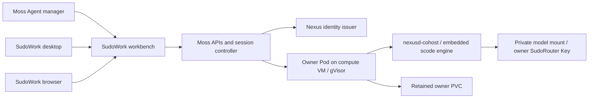

# Shared Agent runtime

Moss and SudoWork use the same native cloud engine. Moss manages placement,
identity, quotas and Agent discovery. SudoWork renders the conversation workbench
for both desktop and browser users.

## Engine and backend

`CohostBackend` is a controller adapter. It connects to `nexusd-cohost` through
Nexus RPC and the native ACP mailbox. The embedded engine runs inside the
owner's Pod; Moss does not execute it inside its server process. Desktop local
execution remains an alternative placement for the same scode engine core.

`UserPodService` creates one gVisor Pod, retained PVC and private NodePort Service
per owner. It uses a namespace-scoped Kubernetes identity. Each execution
controller proves its owner with a short-lived delegated certificate. The Pod
receives its own runtime certificate and private configuration; it receives no
Kubernetes service account token or issuer private key.

## Model credentials and billing

The existing SudoWork/Moss account, recharge and SudoRouter quota services remain
the accounting path. Session startup resolves the model credential for the
session's actual owner. Metered accounts without that credential fail startup.
Metered cohost sessions also require an owner runtime; the legacy shared daemon
cannot receive them using its deployment-level credential.

Both standalone and native engines use the same proxy configuration builder.
The native engine addresses `nexus:///model`; the upstream URL and owner API Key
are supplied to the private model mount at startup. They are not copied into
replicated mount metadata or browser URLs. Changing the mounted provider or Key
requires a controlled runtime restart. The Agent detail page permits owners to
reload their own runtime and settings administrators to reload visible owners.

A management actor does not become the session owner. The server records its
actor ID and Agent context in reserved session metadata. The WebUI accepts the
verified actor after a fresh Moss access check. Manager and owner connections
share the owner's write lock and one upstream conversation.

## Agent discovery and access

`GET /api/v1/agents` combines Moss personal Agents with persistent `/agents/`
directories and the native execution registry. It lists owners permitted by the
current organization and department scope. Owner pages bound discovery work;
failures are returned explicitly. Listing does not provision a missing Pod.

The same Agent name under two owners identifies two different Agents. Legacy
shared directories require owner evidence before attribution. Worker and daemon
entries can be listed, but only managed Agents and configured personal Agents
can start conversations.

`POST /api/v1/agents/:name/sessions` checks creation and attachment permissions,
then creates the conversation using the actual owner's role and scopes. The
manager UI opens the configured SudoWork workbench instead of maintaining a
second conversation renderer. Templates remain separate from live Agent entries.

## Shared release and upgrades

`runtime-release.json` records the observed engine commit, CLI and cohost
versions, compiled Nexus version, plugin ABI, issuer version, image digest and
archive checksum. The CLI and cohost must report the same engine commit. Image
config digests and OCI manifest digests are labeled separately.

Moss consumes `MOSS_RUNTIME_MANIFEST_PATH`. A new runtime must match its image,
binary digest and build provenance. Inspection reports retained runtime drift.
Existing Pods require an explicit upgrade; discovery never silently replaces
them.

An upgrade obtains an owner lock, refuses active work and untracked native
controllers, stops tracked native sessions and replaces the exact observed
Pod UID. The PVC and private Service remain. Moss resumes durable session IDs
with new process IDs. If the replacement fails, it restores the prior Pod spec
and model configuration; drift remains visible. Peer Moss controllers must be
drained before an owner upgrade. A stale upgrade lock or failed rollback requires
operator recovery; it is not automatically deleted without identity evidence.

Owners with session creation and attachment permission may reload their own
runtime after changing a model credential. Changing another owner's runtime
requires `admin:settings`, followed by the organization visibility check. The
detail page uses the same authorization rule as the upgrade endpoint.

Role changes invalidate existing access tokens. SudoWork checks access before
each conversation control frame and terminal input, including established
connections. Idle management subscribers are checked every five seconds.
Management metadata identifies the intended actor and does not replace current
permission.

When owner Pods are configured, session creation and spawn reject `host` and
`docker` execution on the Moss server. Legacy gVisor sessions may continue during
migration. Private deployments without owner Pods retain their existing runtime
choices. SudoWork desktop local execution remains on the user's machine.
With the native cloud default enabled, new sessions cannot select a legacy K8s
placement or override its image and sandbox settings. Existing gVisor sessions
retain their recovery route until their histories are migrated.

## Deployment settings

- `MOSS_WORKSPACE_URL=https://webui.sudoprivacy.com`: shared conversation entry.
- `MOSS_RUNTIME=cohost`: install the native user runtime and its release manifest.
- `MOSS_USER_RUNTIME_HOST`: private compute address for owner Services.
- `MOSS_COHOST_NEXUS_*`: external mTLS credential issuer, independently of the
  main Nexus connection used by Moss storage.
- `MOSS_COHOST_ALLOWED_USERS`: optional rollout cohort; the installer preserves
  the setting, including an explicitly empty cohort.

## Acceptance

`scripts/e2e/cohost-owner-keys.ts` runs real native daemons, delegated identities,
ACP turns, Agent discovery and HTTP requests with two distinct owner Keys. Only
model replies are scripted. This proves routing and isolation, and is separate
from live SudoRouter quota and payment acceptance.

HTTP tests cover organization boundaries, owner runtime roles and reserved
metadata. SudoWork integration tests cover management workbench access, revoked
grants and a shared writer lock between manager and owner. Production migration
requires a published, paired engine release and live gVisor acceptance.

On 2026-10-13, fresh temporary owners passed the paired 0.2.28 release checks on
the actual gVisor compute VM. The CLI and running cohost reported `b2e2c57`; the
cohost executable matched the formally published archive. Two native sessions
returned real `gpt-6-luna` replies through `api.sudorouter.ai`. A deliberately
incorrect executable digest failed replacement and restored the previous Pod
configuration and exact memory/transcript bytes. A subsequent valid replacement
cleared drift and resumed both original durable session IDs with another model
reply. The live workflow is `scripts/e2e/user-pod-release-upgrade.ts`.

This acceptance covers an idle owner controlled by the test. Native quiescing
that atomically rejects a new external controller during the drain check remains
unimplemented. Production cutover must keep native controllers within the Moss
rollout boundary; metered per-account quota acceptance is still separate.

The paired SudoWork change removes the legacy WebUI-host shell. Without an
explicit remote runtime terminal provider, terminal creation returns
`REMOTE_TERMINAL_UNAVAILABLE`. Remote PTY execution, window resizing and Nexus
workspace access still need an owner-runtime implementation and live acceptance.
The old Moss Electron client has a
chat entry in `ui/`; its installed version needs separate acceptance. Its
management entry should reuse the Agent manager and SudoWork workbench.
